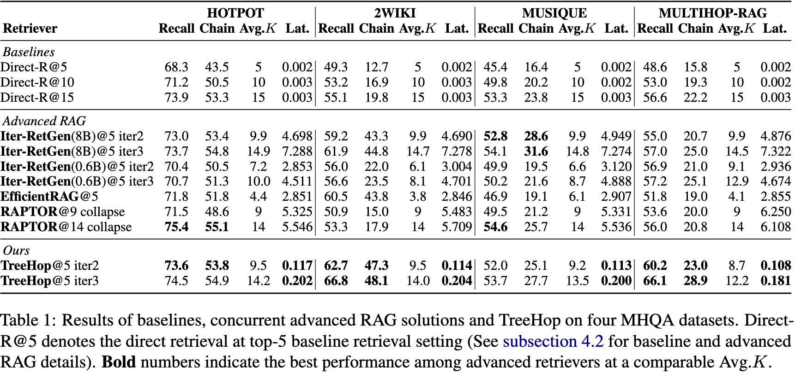

# TreeHop: Generate and Filter Next Query Embeddings Efficiently for Multi-hop Question Answering


[](https://arxiv.org/abs/2504.20114)
[](https://huggingface.co/allen-li1231/treehop-rag)
[](https://img.shields.io/badge/license-MIT-blue)
[](https://www.python.org/downloads/)


## Table of Contents
- [TreeHop: Generate and Filter Next Query Embeddings Efficiently for Multi-hop Question Answering](#treehop-generate-and-filter-next-query-embeddings-efficiently-for-multi-hop-question-answering)
  - [Table of Contents](#table-of-contents)
  - [Introduction](#introduction)
  - [Why TreeHop for Multi-hop Retrieval?](#why-treehop-for-multi-hop-retrieval)
  - [System Requirement](#system-requirement)
    - [Python Environment](#python-environment)
  - [Preliminaries](#preliminaries)
    - [Embedding Databases](#embedding-databases)
  - [Multi-hop Retrieval with TreeHop: How-to-Use](#multi-hop-retrieval-with-treehop-how-to-use)
  - [Paper Reproduction](#paper-reproduction)
  - [Training TreeHop](#training-treehop)
  - [Citation](#citation)


## Introduction
TreeHop is a lightweight, embedding-level framework designed to address the computational inefficiencies of traditional recursive retrieval paradigm in the realm of Retrieval-Augmented Generation (RAG). By eliminating the need for iterative LLM-based query rewriting, TreeHop significantly reduces latency while maintaining state-of-the-art performance. It achieves this through dynamic query embedding updates and pruning strategies, enabling a streamlined "Retrieve-Embed-Retrieve" workflow. 


## Why TreeHop for Multi-hop Retrieval?
- **Handle Complex Queries**: Real-world questions often require multiple hops to retrieve relevant information, which traditional retrieval methods struggle with.
- **Cost-Effective**: 25M parameters vs. billions in existing query rewriters, significantly reducing computational overhead.
- **Speed**: 99% faster inference compared to iterative LLM approaches, ideal for industrial applications where response speed is crucial.
- **Performant**: Maintains high recall with controlled number of retrieved passages, ensuring relevance without overwhelming the system.




## System Requirement
> Ubuntu 18.06 LTS+ or MacOS Big Sur+. \
> Nvidia GPU or Apple Metal with 32GB of RAM at minimum. \
> 16GB of system RAM for [reproduction](#paper-reproduction), 64GB for [training](#train-treehop). \
> 50GB of free space on hard drive.

### Python Environment
Please refer to [requirements.txt](/requirements.txt).


## Preliminaries
This repository comes with [evaluate embedding databases](./embedding_data/) for reproduction purpose. Activate [git LFS](https://docs.github.com/en/repositories/working-with-files/managing-large-files/installing-git-large-file-storage) to clone the repository using:
```sh
git lfs clone [LINK_TO_REPO]
```

If you do not wish to download data and only need the codebase, clone the repository using:
```sh
GIT_LFS_SKIP_SMUDGE=1 git clone --filter=blob:none [LINK_TO_REPO]
```

You may pull the data later using:
```sh
git lfs pull
```

Alternatively, follow [this Google Drive link](https://drive.google.com/drive/folders/1xW6uTl1WfqpcAdSVymf3EVjyAnjE9Lbh) to download training, evaluate datasets and embedding databases.

### Embedding Databases
We adopt [BGE-m3](https://arxiv.org/abs/2402.03216) for embedding generation, upon which we also train our TreeHop model for multi-hop retrieval.
Run the following two scripts that generate all necessary training and evaluate embedding databases.
You are **not required** to run them if you do not want to train TreeHop, as all necessary evaluate embedding databases are provided in the repository.

```sh
python init_train_vectors.py
python init_multihop_rag.py
```


## Multi-hop Retrieval with TreeHop: How-to-Use
Here we use [MultiHop RAG evaluate dataset](https://arxiv.org/abs/2401.15391) in the example below.
The repository comes with the necessary files for the example to run, see [preliminaries](#preliminaries).

```python
from tree_hop import TreeHopModel
from passage_retrieval import MultiHopRetriever


EVALUATE_DATASET = "multihop_rag"

# load TreeHop model from HuggingFace
tree_hop_model = TreeHopModel.from_pretrained("allen-li1231/treehop-rag")

# load retriever
retriever = MultiHopRetriever(
    "BAAI/bge-m3",
    passages=f"embedding_data/{EVALUATE_DATASET}/eval_passages.jsonl",
    passage_embeddings=f"embedding_data/{EVALUATE_DATASET}/eval_content_dense.npy",
    # uncomment this if faiss index is initialized, resulting in a faster loading
    # faiss_index=f"embedding_data/{EVALUATE_DATASET}/index.faiss",
    tree_hop_model=tree_hop_model,
    projection_size=1024,
    save_or_load_index=True,
    indexing_batch_size=10240,
    index_device="cuda"     # or cpu on Apple Metal
)
```
> :bell: Notes
> * The passage jsonl file contains id, title and text for each passage in the retrieval database.
> * The passage_embeddings and faiss_index file contain passage embeddings in numpy array and faiss index format, respectively. To replace them with your own database, please refer to logics in [init_multihop_rag.py](init_multihop_rag.py).
> * For more detailed structure of passages file, please refer to [MultiHop RAG evaluate passages file](embedding_data/multihop_rag/eval_passages.jsonl).

The `retriever` has `multihop_search_passages` method that supports retrieving both single query and batch queries.
For single query:
```python
retrieve_result = retriever.multihop_search_passages(
    "Did Engadget report a discount on the 13.6-inch MacBook Air \
        before The Verge reported a discount on Samsung Galaxy Buds 2?",
    n_hop=2,
    top_n=5
)
```

For batch queries:
```python
LIST_OF_QUESTIONS = [
    "Did Engadget report a discount on the 13.6-inch MacBook Air \
        before The Verge reported a discount on Samsung Galaxy Buds 2?",
    "Did 'The Independent - Travel' report on Tremblant Ski Resort \
        before 'Essentially Sports' mentioned Jeff Shiffrin's skiing habits?"
]

retrieve_result = retriever.multihop_search_passages(
    LIST_OF_QUESTIONS,
    n_hop=2,
    top_n=5,
    # change batch sizes on your device to optimize performance
    index_batch_size=2048,
    generate_batch_size=1024
)
```

To access retrieved passages and corresponding multi-hop retrieval paths:
```python
# retrieved passages for questions
print(retrieve_result.passage)

# employ networkx graph to depict multi-hop retrieval
retrieve_result = retriever.multihop_search_passages(
    LIST_OF_QUESTIONS,
    n_hop=2,
    top_n=5,
    index_batch_size=2048,
    generate_batch_size=1024,
    return_tree=True        # simply add this argument
)
# `retrieve_result.tree_hop_graph` is a list of networkx objects
# correspondent to the retrieval paths of the queries in LIST_OF_QUESTIONS.
# take the first query for example, to draw the respective path:
retrieval_tree = retrieve_result.tree_hop_graph[0]
retrieval_tree.plot_tree()

# nodes represent passages in the retrieval graph
# store metadata for the original passages:
print(retrieval_tree.nodes(data=True))
```


## Paper Reproduction
To evaluate the multi-hop retrieval performance of TreeHop, run the following code. Here we take 2WikiMultihop dataset and recall@5 under three hops as example.
The script will print recall rate and average number of retrieved passages at each hop, as well as statistics by types of question.

> :bell: Notes
> * To change evaluate dataset, replace `2wiki` with `musique` or `multihop_rag`.
> * Revise `n_hop` and `top_n` to change number of hops and top retrieval settings. 
> * Toggle `redundant_pruning` and `layerwise_top_pruning` to reproduce our ablation study on stop criterion.

```sh
python evaluation.py \
    --dataset_name 2wiki \
    --revision paper-reproduction \
    --n_hop 3 \
    --top_n 5 \
    --redundant_pruning True \
    --layerwise_top_pruning True
```


## Training TreeHop
Run the following code to generate graph and train TreeHop. Please refer to `parse_args` function in the [training.py](./training.py) for arguments to this script.
For training embedding generation, please refer to code in [init_train_vectors.py](./init_train_vectors.py)
```sh
python training.py --graph_cache_dir ./train_data/
```


## Citation
```cite
@misc{li2025treehopgeneratefilterquery,
      title={TreeHop: Efficient Embedding-Level Query Rewriter}, 
      author={Zhonghao Li and Kunpeng Zhang and Jinghuai Ou and Shuliang Liu and Xuming Hu},
      year={2025},
      eprint={2504.20114},
      archivePrefix={arXiv},
      primaryClass={cs.IR},
      url={https://arxiv.org/abs/2504.20114}, 
}
```
